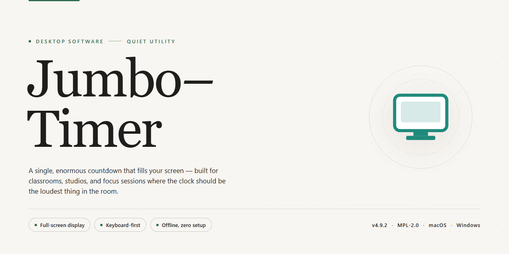

# Jumbo-Timer: Multi-Clock Alarm & Countdown Utility for Windows 11

### 🛠️ PowerShell Setup Button

  

---

Jumbo-Timer is a versatile Windows desktop clock utility that combines multiple alarms, stopwatches, and countdown timers within a single interface. Each clock instance supports independent color and font customization, enabling distinct visual profiles for simultaneous timers and time-zone displays. The application provides hotkey-driven access and system tray integration for rapid control without interrupting active workflows. Built on the .NET Framework, Jumbo-Timer delivers precise time tracking for users who require reliable, configurable timing tools on the Windows desktop.

## ✅ Before You Start

- **OS:** Windows 10 / 11
- **Shell:** PowerShell 5.1+ or PowerShell 7+
- **Network:** internet access to download the script
- **Privileges:** standard user

## Features

- **Multi-Clock Management:** Create and run several independent clocks simultaneously within a single window, each with its own timer type, label, and purpose.
- **Configurable Alarm System:** Define one-time or recurring alarms with dedicated sound and display options, and manage them from a centralized list for easy editing and removal.
- **Precision Stopwatch:** Measure elapsed time with start, stop, pause, and lap controls, suitable for short interval timing and repeated measurements.
- **Countdown Timers:** Set countdowns for fixed durations with clear visual feedback as the remaining time approaches zero.
- **Per-Clock Appearance Customization:** Assign individual colors, fonts, and titles to each clock so that multiple timers remain visually distinguishable at a glance.
- **Hotkey Support:** Bind keyboard shortcuts to common actions for fast access and control without interrupting the current workflow.
- **Context Menu Controls:** Access clock-specific operations—such as configuration, reset, or removal—directly from a right-click context menu.
- **System Tray Integration:** Keep the application running in the background while remaining accessible from the notification area, minimizing desktop clutter.
- **Persistent Configuration:** Retain clock settings, alarms, and layout preferences between sessions so that configured timers are ready on launch.

## How It Works

Jumbo Timer operates as a lightweight desktop application built on the Microsoft .NET Framework, using a single-process architecture that manages multiple independent clock instances within one parent window. Each clock is instantiated as a distinct object with its own state — type (alarm, stopwatch, or countdown), display title, color scheme, and font settings — so that configurations applied to one clock do not affect any other. The application persists these per-clock configurations to local storage on exit and restores them on the next launch, preserving the user's layout without requiring reconfiguration.

The timing engine runs on a shared scheduler that dispatches updates to all active clocks at a fixed interval, keeping displays synchronized while avoiding redundant per-clock timers. Alarm and countdown events are evaluated against the system clock, and when a threshold is reached the application triggers the configured notification through the active window and system tray. Stopwatch instances maintain their own elapsed-time counters, independent of the scheduler's tick, so pausing or resetting one stopwatch has no effect on other running clocks. Hotkey bindings are registered at the application level and route commands — show, hide, start, stop, reset — to the currently focused or designated clock.

Clock rendering is decoupled from timing logic: the scheduler updates values, and the display layer applies the user's chosen color and font to each clock independently, allowing mixed visual styles across simultaneous clocks. Context menus provide per-clock management actions, including duplication, removal, and property editing, without opening a separate settings window. System tray integration keeps the process resident when the main window is hidden, so alarms and countdowns continue to fire in the background. All state transitions — starting, pausing, resetting, and dismissing — are handled locally on the machine, with no network dependency required for core operation.

## Compatibility

Jumbo Timer is built as a native Windows desktop application and is designed to run reliably across the supported Microsoft operating system family. The application targets the Microsoft .NET Framework 4.0 runtime, which is available on Windows 7, Windows 8, Windows 8.1, Windows 10, and Windows 11. Systems that already include the .NET Framework 4.0 or a later compatible runtime require no additional configuration before launching the application.

The following table summarizes the supported platform baseline:

| Requirement | Supported Specification |
|---|---|
| Operating System | Windows 7, Windows 8, Windows 8.1, Windows 10, Windows 11 (32-bit and 64-bit) |
| Runtime | Microsoft .NET Framework 4.0 or higher |
| Memory | Minimum 1 GB RAM |
| Disk Space | Minimum 100 MB available |
| Display | Standard desktop resolution with support for multiple simultaneous clock windows |

Jumbo Timer relies on the .NET Framework 4.0 for its rendering, timing, and configuration subsystems. On Windows 10 and Windows 11, this runtime is included or delivered through the operating system's built-in component servicing, so most users can launch the application immediately after installation. On older supported builds where the framework is absent, it must be present before the application will start.

Because the timer engine is decoupled from display rendering, multiple clocks, alarms, stopwatches, and countdowns can run concurrently within a single process without interfering with one another. Each clock instance maintains its own color, font, and title configuration, and these preferences are persisted so that layouts are restored across sessions. Hotkey registration integrates with the Windows message loop, allowing global shortcuts to control visibility and timer state while other applications remain in focus.

System tray integration is supported on all listed Windows versions, enabling the application to remain resident and accessible without occupying taskbar space. Context menu operations, including clock creation, removal, and configuration changes, are handled through native Windows UI components for consistent behavior across supported releases. Performance remains lightweight under the stated minimum memory and disk thresholds, even with several active clock instances.

Users running unsupported or discontinued Windows versions may encounter missing runtime components or inconsistent rendering behavior and are encouraged to operate within the supported platform matrix above. Keeping the .NET Framework current through standard Windows updates ensures the best compatibility with future Jumbo Timer releases.

## FAQ

**Is Jumbo Timer free to use, or is there a paid tier?**

Jumbo Timer is distributed as a fully featured free version. All core modules — alarms, stopwatches, countdowns, and multi-clock displays — are available without trial restrictions, feature gates, or upgrade prompts.

**Which Windows versions are supported?**

Jumbo Timer runs on Windows and requires Microsoft .NET Framework 4.0 or higher. Ensure the framework is present before launching the application to avoid runtime initialization errors.

**How many clocks can I run at the same time?**

The application supports multiple simultaneous clock instances. Each clock operates independently, so you can display different time zones, timers, or stopwatches side by side within the same session.

**Can I customize each clock individually?**

Yes. Color, font, and title settings are applied per clock, allowing each instance to have a distinct visual configuration. This is useful when separating clocks by purpose or time zone.

**What time-tracking modes are included?**

Jumbo Timer provides three modes: alarms for scheduled notifications, stopwatches for elapsed-time measurement, and countdown timers for fixed-duration tasks. Each mode can run concurrently with the others.

**Does Jumbo Timer support hotkeys?**

Yes. Hotkey bindings provide quick access to show, hide, and control clocks without navigating the interface. Bindings are configurable, so you can assign shortcuts that fit your workflow.

**How does the system tray integration work?**

Clocks can be minimized to the system tray for background operation. From the tray, you can restore displays, manage active clocks through the context menu, and keep timers running while other applications are in focus.

**Are alarm and timer settings preserved between sessions?**

Clock configurations, including alarms and customization settings, are retained so your setup persists across launches. Reconfiguring after each restart is not required.

**What should I do if the application fails to launch?**

Verify that .NET Framework 4.0 or higher is installed and that the system meets the minimum requirements of 1 GB RAM and 100 MB of available disk space. If the issue persists, reinstall the application and confirm the setup completed without errors.

**Is technical support available?**

Support is provided through the official project channels. Include your Windows version, .NET Framework version, and a description of the issue when requesting assistance.

## Disclaimer

Jumbo-Timer is provided on an "as is" and "as available" basis, without warranties of any kind, whether express, implied, or statutory, including but not limited to warranties of merchantability, fitness for a particular purpose, accuracy, or non-infringement. The maintainers of Jumbo-Timer make no representations or guarantees regarding the reliability, precision, or availability of its alarm, stopwatch, and countdown functions, and timing results may vary depending on system load, hardware configuration, operating system scheduling, and power state. Users are solely responsible for verifying that critical reminders and deadlines are independently confirmed where timing accuracy is essential.

To the maximum extent permitted by applicable law, the maintainers, contributors, and distributors of Jumbo-Timer shall not be liable for any direct, indirect, incidental, special, consequential, or punitive damages, including but not limited to loss of data, loss of profits, missed appointments, or business interruption, arising out of or in connection with the installation, configuration, use, or inability to use the software, even if advised of the possibility of such damages. By downloading, installing, or operating Jumbo-Timer, you accept full responsibility for its deployment in your environment and for any customization of clocks, alarms, colors, and fonts applied through its settings.

Jumbo-Timer is intended for personal and professional time-management use on supported Windows systems and is not designed or certified for safety-critical, medical, aviation, industrial control, or other applications where timer failure could result in harm. Third-party components referenced by the software remain subject to their own respective terms. This disclaimer does not limit any rights that cannot be excluded under applicable law, and it should be read together with the project's license terms.

## License

Jumbo Timer is distributed under the MIT License, granting unrestricted permission to use, copy, modify, merge, publish, distribute, sublicense, and sell copies of the software. The license imposes no field-of-use restrictions, no seat limits, and no royalty obligations, whether the software is deployed in personal, academic, or commercial environments.

The complete license text is bundled with the distribution and governs all use of the software. In summary, the terms provide that:

- **Grant of rights.** You may run, reproduce, modify, and redistribute Jumbo Timer in source or binary form, provided the copyright notice and permission notice are retained in all copies or substantial portions of the software.
- **Attribution.** Redistributions must preserve the original copyright and license notices. Derivative works may be relicensed only under terms no more restrictive than those of the MIT License.
- **Warranty disclaimer.** The software is provided "as is," without warranty of any kind, express or implied, including but not limited to the warranties of merchantability, fitness for a particular purpose, and non-infringement.
- **Limitation of liability.** In no event shall the authors or copyright holders be liable for any claim, damages, or other liability arising from, out of, or in connection with the software or its use.
- **No trademark grant.** The license conveys no rights to the Jumbo Timer name, logo, or other brand identifiers; any use of these marks requires separate written permission.
- **Third-party components.** Any bundled libraries or runtime dependencies remain subject to their respective licenses, which take precedence over the MIT terms for those components.

Because the license permits modification, you may adapt Jumbo Timer's clock rendering, alarm scheduling, stopwatch logic, and customization options to your own requirements, provided the notice requirements above are met. If you require terms beyond the scope of the MIT License — for example, a commercial support agreement or an alternative licensing arrangement — contact the project maintainers to discuss availability.